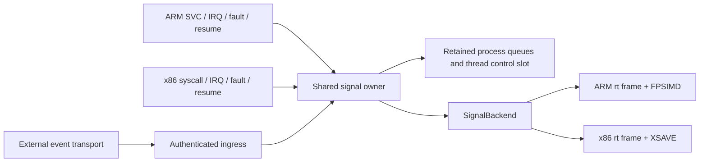

# ARM signals in the shared in-ring owner

Design for [#285](https://github.com/carrick-sh/carrick/issues/285).
Implementation awaits director approval. The
[owner decision on #231](https://github.com/carrick-sh/carrick/issues/231#issuecomment-6131879674)
forbids a temporary ARM signal crossing and requires reuse of x86's in-ring
owner. This document changes no routing, runtime behaviour or acceptance
baseline. The unfinished host-dispatch trace script was discarded: it had
never been live-qualified and depended on a forwarding diagnostic control.

## Outcome and boundaries

ARM and x86 use one Linux signal policy and one process/thread state owner.
The guest kernel performs action updates, pending selection, handler admission,
frame publication and signal return. A carrier conveys external events and
execution capacity; it neither chooses a guest disposition nor constructs a
guest signal frame. Different ISAs encode different user frames through the
existing `SignalBackend` interface.

The first implementation slice serves ARM `rt_sigaction`, `rt_sigprocmask`
and `sigaltstack`, including their error and aliasing cases. It must remove
the SIGPIPE startup assertion signature from the signed `el1_` run. That
requires an actual signal-owner cutover, not just changing ordinal 134's route:
a caught disposition must be visible to the same owner that delivers and
returns from the handler. Subsequent slices add send/wait and lifecycle
coverage and remove the unreachable carrier implementation.

The 68 failures reported on #285 are the starting failure set, not permission
to ignore a new failure. Each slice preserves previously passing tests on
both ISAs and reports `NEW=[]` against its main control, plus the exact
`FIXED` set. Removing the SIGPIPE signature is distinct from making all 68
tests pass: later execution can expose an independent defect. Record those
failures without retries, new ignores, larger budgets or weaker assertions.

## Today's ownership

The source anchors below were checked in the current GitHub-main checkout.
They are navigation for this design, not a line-count or debt-ratchet inventory.
The older [signal status note](in-ring-signals-status.md) describes the same
split, but some older design notes still name the removed x86 `entry.rs`.

### x86 CPL0 and shared guest state

| Surface | Current owner and call site |
|---|---|
| Dispositions and process pending payloads | [`native_process_signals.rs:39`](../../crates/carrick-el1/src/personality/native_process_signals.rs#L39): `SignalResources` holds `ActionTable`, `SignalInbox<TaskKey, T>`, record-specific pending queues and forced-SEGV records under one retained spinlock. `install_action` at :85 exchanges the action and drops ignored pending instances. |
| Linux disposition/mask policy | [`policy.rs:164`](../../crates/carrick-signal-core/src/policy.rs#L164): `ActionTable`; handler masking at :127; reset-hand selection at :207; handler-return policy at :113. These are already independent of ISA and host. |
| Pending ordering and payload ownership | [`signal.rs:32`](../../crates/carrick-personality-linux/src/signal.rs#L32): `PendingSignals`; `take_pending` at :129 selects from thread and process queues. [`native_process_signals.rs:223`](../../crates/carrick-el1/src/personality/native_process_signals.rs#L223) consumes against the caller's `RecordRef`, preserving forced signals and currently deferring default stops. |
| Exact process syscall authority | [`native_process_runtime.rs:4472`](../../crates/carrick-el1/src/personality/native_process_runtime.rs#L4472): `NativeProcessEntry::rt_sigaction` resolves the exact task row and its retained signal resources. `current_signals` at :923 authenticates the binding, control slot, record incarnation, MM and thread generations. |
| Signal wire adapter | [`signal.rs:495`](../../crates/carrick-personality-linux/src/signal.rs#L495): the shared `invoke` action arm validates size/signum, copies the wire action and invokes `ProcessSignals`. SA_RESTORER is already decoded at :534. [`dispatch.rs:631`](../../crates/carrick-personality-linux/src/dispatch.rs#L631) routes x86's canonical signal family. |
| Per-thread blocked mask and alternate stack | [`lifecycle.rs:547`](../../crates/carrick-personality-linux/src/lifecycle.rs#L547) and :597 use the retained `LifecycleThread.slot`. [`lifecycle.rs:575`](../../crates/carrick-el1/src/personality/lifecycle.rs#L575) reads the same slot for `SignalNative`. A `ThreadControlSlot`, not the carrier pthread, owns these values. |
| Frame interface and x86 codec | [`signal.rs:907`](../../crates/carrick-personality-linux/src/signal.rs#L907): `SignalBackend`; [`x86_signal.rs:16`](../../crates/carrick-el1/src/personality/x86_signal.rs#L16) builds the x86 rt frame and XSAVE image; :169 validates/restores it. [`linux_personality.rs:246`](../../crates/carrick-x86-cpl0/src/linux_personality.rs#L246) binds the codec to native entry. |
| Delivery orchestration | [`linux_personality.rs:307`](../../crates/carrick-x86-cpl0/src/linux_personality.rs#L307): `deliver_signal_on_syscall_return` selects an action, handles child-wait restart, chooses the stack, invokes the codec and commits the handler mask. `force_delivery_fault` at :418 supplies forced-SEGV escalation. This policy-bearing sequence must move, not be copied for ARM. |
| Delivery points | [`linux_personality.rs:1058`](../../crates/carrick-x86-cpl0/src/linux_personality.rs#L1058): completed syscall after the work ledger; :458 user return; :528 IRQ return; :733 synchronous page-fault delivery; :524 scheduler syscall-return hook. Machine-frame conversions and scheduler transfer remain ISA leaves. |
| Fork and exec disposition rules | [`native_process_signals.rs:307`](../../crates/carrick-el1/src/personality/native_process_signals.rs#L307): `reset_for_exec` preserves ignored actions; :314 copies actions and clears pending state for fork. [`policy.rs:183`](../../crates/carrick-signal-core/src/policy.rs#L183) defines exec inheritance. |

The mask/stack lifecycle adapter is only a partial in-ring implementation today.
[`lifecycle.rs:554`](../../crates/carrick-personality-linux/src/lifecycle.rs#L554)
declines on a wrong size, overlapping buffers, copy failure or invalid `how`.
The alternate-stack arm at :597 declines for an active stack, unsupported
flags and undersized storage. These are not acceptable host-fallback cases
after the cutover; they must complete with the Linux result in-ring.

### ARM EL1 and carrier state

| Surface | Current owner and call site |
|---|---|
| ARM routing | [`dispatch.rs:603`](../../crates/carrick-personality-linux/src/dispatch.rs#L603) preserves 132/135 as lifecycle calls, 139 as `SignalReturn`, and refuses 129–131, 133/134, 136–138 and 240 as unported. Thus the entire 129–139 range is **not** uniformly unported. |
| ENOSYS before action validation | [`dispatch.rs:879`](../../crates/carrick-personality-linux/src/dispatch.rs#L879) applies strict crossing admission; [`crossing.rs:403`](../../crates/carrick-personality-linux/src/crossing.rs#L403) installs -38. ARM action bytes are not inspected on this route. |
| Missing production process venue and disconnected signal venue | [`dispatch.rs:422`](../../crates/carrick-el1/src/personality/dispatch.rs#L422) supplies `process: None` to ARM's live pipeline. :700 returns no ARM `signal_native`; [`lifecycle.rs:566`](../../crates/carrick-el1/src/personality/lifecycle.rs#L566) returns no ARM process signal venue. `TrapFrame`'s dispatch adapter also has no concrete frame-restore implementation. |
| Carrier dispositions and pending payloads | [`objects/signal.rs:34`](../../crates/carrick-kernel/src/kernel/objects/signal.rs#L34): kernel `Sighand`; :330 `TaskPendingSignals`; :642 `ThreadSignalState`; :1096 `SignalAuthority`. [`dispatch/signal.rs:2048`](../../crates/carrick-kernel/src/dispatch/signal.rs#L2048) is the host action adapter when an admitted call reaches it. |
| Mask/stack storage already shared with EL1 | [`objects/thread.rs:2831`](../../crates/carrick-kernel/src/kernel/objects/thread.rs#L2831): the control slot is the sole mask/stack storage. :2888 overlays snapshots; :2896 writes changed values back and clears the snapshot fields. Do not invent another mask/stack table during migration. The carrier still owns handler-frame history and pending payload decisions. |
| Carrier selection and handler entry | [`vcpu_loop/signal.rs:1941`](../../crates/carrick-runtime/src/vcpu_loop/signal.rs#L1941) drains host/xsignal queues, selects via the kernel authority and calls `inject_signal` at :2145. [`vcpu_loop/mod.rs:2283`](../../crates/carrick-runtime/src/vcpu_loop/mod.rs#L2283) handles resulting stop/termination. |
| Carrier ARM frames | [`engine.rs:4919`](../../crates/carrick-aarch64/src/engine.rs#L4919)'s injection calls `GuestArch::build_sigframe` at :4990; :4998 restores it. The host codec is [`sigframe.rs:93`](../../crates/carrick-hal/src/sigframe.rs#L93), restore at :395, backed by [`signal.rs:457`](../../crates/carrick-syscall-abi/src/signal.rs#L457)'s `CarrickSigframe`. |
| SignalReturn handback | [`dispatch.rs:555`](../../crates/carrick-personality-linux/src/dispatch.rs#L555) lowers `Family::SignalReturn` to handback. [`binding.rs:3705`](../../crates/carrick-runtime/src/vcpu_loop/binding.rs#L3705) restores via the engine, restores the kernel mask and services more signals without publishing a syscall result. |
| Dormant ARM guest codec | [`arm_signal.rs:35`](../../crates/carrick-el1/src/personality/arm_signal.rs#L35) builds; :6 restores; :214 binds `SignalBackend`. It still requires Carrick's private magic and reads only an initial fixed FPSIMD record. It is not equivalent to the carrier's foreign-frame handling at [`sigframe.rs:401`](../../crates/carrick-hal/src/sigframe.rs#L401). Enabling it unchanged is not the design. |
| ARM entry boundaries | [`dispatch.rs:302`](../../crates/carrick-el1/src/personality/dispatch.rs#L302) routes SVC/IRQ/abort; :431/:519 feed the shared dispatcher. The cutover must add the common signal checkpoint on actual EL0 return, including resumed records, not just forwarded SVCs. |

## Shared owner and ISA boundary

Keep `ActionTable`, `PendingSignals`, `NativeProcessSignals` and
`NativeProcessEntry` as the one existing state and process authority. Move
the selection-to-publication sequence out of x86 `linux_personality.rs`
into a focused `carrick-el1/src/personality/signal_delivery.rs` module.
Both ISA entry adapters invoke it. Linux flags, default actions, masks,
pending queues, restart decisions, alternate-stack transitions, forced-SEGV
escalation and child-exit effects stay in Linux personality/policy code;
the neutral substrate does not acquire Linux signal numbers or frame types.

The shared delivery entry consumes an authenticated process entry, the
retained control slot, an interrupted user context, the completed entry's
work state and a `SignalBackend`. Its outcome is a returned user context,
an owned suspension or committed process termination. It is not a boolean
invitation for the host to try another signal implementation. The ISA
adapter converts machine frames, captures/restores FP state and applies
that outcome to its scheduler. Restart-PC arithmetic is an ISA operation:
the shared owner must not copy x86's two-byte syscall rewind onto ARM.

The current `SignalBackend::restore_signal_frame` returns only a blocked
mask. Extend that shared seam to carry validated alternate-stack restoration
as well; otherwise SS_AUTODISARM cannot be implemented correctly. Decode
the full restore proposal and validate its stack/mask policy before any
machine register is published. Both codecs use that same commit sequence.
A legal rebuilt public frame does not require a private handler-history
token; retained history is for owned continuations, not ABI authentication.

The ownership rules are:

- One action/payload consumer per exact task generation. A carrier event
  never enters both the kernel host queue and the native guest queue.
- `TaskKey`, binding generations and `RecordRef` are preserved throughout
  directed delivery. A numeric tid lookup miss during admitted birth is
  not proof of death; stale generations cannot signal a replacement task.
- The control slot remains the mask/stack store. Pending bits are summaries
  of the owner's queues, not substitute queues. Preserve the existing
  sender/masker publication ordering and wake responsibility.
- Action selection and SA_RESETHAND publication remain under one sighand
  admission. After selection, retain that action and siginfo across any
  user-copy suspension; do not dequeue again or borrow a newer disposition.
- Settle the original syscall's completion/work ledger before handler
  entry. Partial I/O retains byte progress and its owner; SA_RESTART is a
  semantic restart decision, not unconditional syscall replay.
- Frame copy completes before publishing handler registers and mask/stack
  state. Restore validates all user-controlled state before publication.
  Guest-copy waits release executor capacity; none park a carrier worker
  waiting for another guest task.
- Failed frame admission forces an exact-thread SIGSEGV. Failure to admit
  that SIGSEGV frame terminates that process; the parent/carrier survives.
  Multi-member exit and stop/continue need shared process-owner custody,
  not x86's currently named dependency guard applied to ARM.

### Exact setup-call semantics

The shared adapter must serve all outcomes for its routed calls. Repair
`serve_sigprocmask` and `serve_sigaltstack` in place for both ISAs; do not add
ARM-specific replacements for their current decline cases.

`rt_sigaction` accepts the kernel's eight-byte mask size, validates signal
numbers and rejects installation on KILL/STOP while allowing queries. Preserve
handler, supported flags, restorer and filtered mask through install/query,
including SA_RESTORER on ARM. Pointer aliasing and fault side effects are
checked against raw-syscall oracle cases; no host-pointer assumptions or
installation-time executable-address test is added. Pin flag probing and
SA_UNSUPPORTED/SA_EXPOSE_TAGBITS to the advertised ARM feature set rather
than treating the existing boolean `ActionFlags` as proof of complete ABI
coverage. Authority: [sigaction(2)](https://man7.org/linux/man-pages/man2/sigaction.2.html).

`rt_sigprocmask` serves BLOCK/UNBLOCK/SETMASK and queries; a NULL set ignores
`how`. It cannot block KILL/STOP. Invalid size/how returns -22; inaccessible
memory returns -14. Read the input before copying the old output even when
they alias, and pin mutation-on-copyout-failure with the oracle. Query the
native pending owner after publication and deliver through the ring's user
return checkpoint, not carrier signal work.
Authority: [sigprocmask(2)](https://man7.org/linux/man-pages/man2/sigprocmask.2.html).

`sigaltstack` serves queries while on stack, active-stack change refusal
(-1/EPERM), invalid flags (-22), undersized storage (-12/ENOMEM) and bad
addresses (-14). Include input/output overlap, stack boundaries,
SS_DISABLE and SS_AUTODISARM. The minimum belongs to an explicit ISA ABI
policy validated against the raw ARM/x86 oracle; the current shared 2048
constant cannot silently define ARM semantics. Handler entry saves stack
settings, applies autodisarm and restores the saved settings on sigreturn.
Authority: [sigaltstack(2)](https://man7.org/linux/man-pages/man2/sigaltstack.2.html).

## ISA-specific frames

Reuse the canonical wire records in `carrick-syscall-abi`, not duplicate
definitions in either adapter. ARM's public frame starts with siginfo and
ucontext; its machine context carries x0–x30, SP, PC, PSTATE and an aligned
extension-record area for FP/SIMD state. x86 has its own ucontext, return
trampoline word, red-zone/alignment rules and XSAVE image. The common owner
handles stack/mask lifecycle and result ownership; each codec handles byte
layout, architectural feature validation and register publication.

Pure byte encoders/validators belong in ISA-named modules under
`carrick-personality-linux::signal`; `carrick-el1`'s `SignalBackend` adapters
retain access to native machine frames and user-copy permits. Move the
existing pure bodies there rather than maintaining host and guest copies.
Non-ARM host backend consumers can use those pure functions through their
personality adapter. They must not add a HAL-to-EL1 dependency cycle or put
Linux record interpretation back into the neutral HAL.

Replace the dormant ARM codec's private-magic prerequisite with decoding of
the public rt frame. Move the useful pure encoding/validation from the
carrier codec into that single ARM codec and delete the redundant algorithm
as it becomes unreachable. A handler may modify its saved context or supply
a rebuilt public frame; Carrick-only trailing fields cannot be required.
Validate EL0 privilege state, user addresses, alignment and context records
before committing registers, masks, alternate stack or FP state. Successful
`rt_sigreturn` restores the context without overwriting x0 with an errno or
zero. Invalid frames enter the same forced-SEGV path as failed delivery.
Authority: [sigreturn(2)](https://man7.org/linux/man-pages/man2/sigreturn.2.html).

The ARM adapter retains explicit-restorer and user-trampoline fallback
behaviour for the admitted ABI, preserves V0–V31/FPSR/FPCR and bounds parsing
by the admitted frame extent. The record walk validates lengths, alignment,
termination, duplicates and feature compatibility; it cannot assume FPSIMD
is simply the first record. Extend the frame only for features actually
advertised by the guest CPU. SVE/SME support is not introduced by this work;
their absence must agree with HWCAP and the feature controls. The public
[AArch64 signal-context documentation](https://www.kernel.org/doc/html/latest/arch/arm64/sve.html#signal-handling)
describes FPSIMD as a required companion to SVE and the extension area, and
the [ABI presentation, slides 9–11](https://blog.linuxplumbersconf.org/2017/ocw/system/presentations/4671/original/plumbers-dm-2017.pdf)
shows the ARM frame/record structure. Do not follow source-header references
from those documents. Numeric layouts not already validated in Carrick
require public-document evidence plus native ARM oracle observations.

## Retiring the carrier consumer

Every newly admitted ARM execution binding uses the native signal owner.
Admission publishes one owned signal-domain capability with its record
generation; it cannot leave a host `Sighand` as a competing consumer for
that binding. This is a completed migration boundary, not a configurable
rollout flag. Roots begin with Linux guest defaults; no Darwin carrier
disposition is imported. Guest fork/clone/exec inheritance follows the
retained native authority, including CLONE_SIGHAND sharing.
MM sharing (including vfork) does not by itself license sighand sharing;
use the actual clone flags. An opt-out for unrelated ARM routing cannot
select a second carrier-owned signal path after this cutover.

External sources (CLI terminal, timer/real external events and hardware
fault notifications that reach the host) become bounded ingress records
authenticated against the binding and event generation. The Linux
personality translates the payload; the neutral carrier only publishes an
opaque event and requests a guest boundary. A full transport retains an
owned admission/backpressure continuation instead of dropping a signal.
Consumption and coalescing occur once in the native pending owner. There
is no new guest signal syscall crossing and no host readiness pipe.

Install the shared checkpoint on SVC completion, IRQ/preemption return,
fault completion, scheduler resume and completion of owed carrier work.
Never inject at an EL1 PC or into a frame still owned by a parked syscall.
The host stops calling `deliver_signal_with_restart`, `inject_fault_signal`
and `engine.inject_signal` for an ARM binding at the same cutover. A carrier
fault forwards an event, not a prepared disposition or handler frame.
ARM ordinal 139 moves from `SignalReturn` to the common signal family in
that same slice; it never hands back to `engine.restore_from_sigframe`.

Delete the retired ARM handler-frame/mask restoration consumers and engine
codec entry points once all users have been redirected. Retain physical
host signal handlers needed for the carrier's own operation and genuine
external ingress. Audit their callers before deletion: the cutover cannot
remove a still-live non-ARM backend's service. Such consumers must eventually
use the same policy/codec through their execution adapter, not a copied ARM
implementation. Completion telemetry must distinguish guest signal death
from carrier death and identify the owning task/record.

## Landing slices

### Admission prerequisite owned by the ARM process lane

The first signal slice depends on the production ARM process venue landing
through [#186](https://github.com/carrick-sh/carrick/pull/186), including
exact parked-root custody from [#272](https://github.com/carrick-sh/carrick/pull/272)
and its associated admission work. Today's main passes `process: None`;
`Aarch64NativeProcessService` existing as a library type is not live adoption.
Require authenticated root admission before the first setup syscall, native
entry access to the retained signal resources, and correct imported thread
membership for already-live records. The admission sub-slice of
[#322](https://github.com/carrick-sh/carrick/issues/322) binds these requirements
in `process.native.arm-admission`; stock supply/completion and the narrowed
signed COW fixture remain later sub-slices of that issue. Do not duplicate the adoption code,
construct a signals-only second process graph or invent host rows for
native children to make this design independently boot.

This is an external prerequisite, not an unbudgeted slice zero on this
branch. It must land with its own red-first admission witness and `NEW=[]`
against main; otherwise the director must revise the stack/landing order
before signal implementation. #285's baseline failures remain until the
signal cutover. Coordinate native-child signals with
[#217](https://github.com/carrick-sh/carrick/issues/217), which already owns
that milestone; interval timers and child exec are dependencies in that
issue, not additional mechanisms hidden inside the signal setup slice.

The following names are proposed witnesses, not test results. Each numbered
slice is one independently gated PR, at most **2,000 added plus deleted
lines**, including tests, generated files and moves (count both sides).
Numbers are planning budgets, not measured claims. If slice 1 cannot fit
its atomic cutover, return the decomposition for approval before coding or
landing an action-only half migration; do not exceed the cap or add a shim.
Each slice starts from GitHub main and retains the preceding slice's tests.

### 1. ARM setup calls and one delivery/return owner (budget 1,950 lines)

Files: existing shared `signal.rs`/`lifecycle.rs`, native signal resources
and entry adapters on the landed process venue; move x86 delivery to the
common module; ARM frame codec
and the minimal authenticated event/return glue. Allocate 400 lines for the
move, 250 for setup-call semantics, 350 for ARM entry/ingress and disabling
the carrier consumer, 300 for frame corrections, 550 for witnesses and
100 for contract/documentation binding. Do not port send/wait syscalls here.

Before changing routing, capture the actual failing startup SVC's six
arguments, four copied action words, result and errno through a bounded
in-ring diagnostic snapshot exported by `carrick trace`. The host
`syscall-entry`/`sigaction-read` probes do not observe the current refusal.
Keep the original strict route during the red capture; zero events fail
the capture, and a forwarding opt-out is not a substitute. Retain only
needed diagnostics with their live-qualified ABI and perturbation header.

- Red first: `arm_signal_setup_uses_one_native_owner` exercises exact
  captured libc startup action words through production ARM dispatch;
  today ordinal 134 returns -38. Include another signal, a caught action
  delivered at a user boundary, action query, mask aliasing/errors and
  stack query/EPERM/autodisarm. Existing x86 tests run the same shared policy.
- Red first: `arm_public_signal_frame_roundtrip_has_no_private_magic`
  restores a valid public frame with nonzero saved x0 and FP/SIMD values;
  the dormant codec currently refuses its absent private magic. Include
  malformed records and no-publication-on-failure assertions.
- Exit: 132/134/135 are served in-ring for successes **and errors**;
  139 restores in-ring; a caught action is delivered and returned by that
  same owner. Unported send/wait ordinals still return counted ENOSYS.
  Carrier selection/frame injection is unreachable for native ARM bindings.
  No new signal crossing or fallback is introduced.
  Previously supported asynchronous/default-fatal behaviour is a required
  control: the first cutover cannot replace it with the x86 group-exit
  dependency guard. If that needs more lifecycle work than the budget
  allows, the director must revise the slice boundary before implementation.
- Signed exit: `el1_transparent_smoke` and `el1_files_contract` pass; the
  `el1_` receipt has **zero SIGPIPE assertion occurrences**, `NEW=[]`, and
  exact fixed/still-failing counts. Preserve raw stderr/stdout from all
  selected tests, even if the first artifact fails. New source fixtures
  require a freshly published input-identity-valid Linux bundle.

### 2. Directed sends and pending identity (budget 1,700 lines)

Files: shared `signal.rs`, `native_process_signals.rs` and
`native_process_runtime.rs`; ARM routing and ingress admission tests.
Bind 129/130/131/136/138/240 to the existing owner without duplicating x86
send algorithms. Complete shared credentials, signal-zero probes, selectors,
siginfo provenance and real-time pending quotas wherever the corpus exposes
a missing shared rule. Do not claim x86's deferred permission/quota work is
already complete.

- Red first: `arm_two_live_tasks_directed_signal_keeps_generation` sends
  to a secondary thread during admitted birth and after record reuse;
  main refuses the send. Verify exact recipients, payloads, duplicate
  standard-signal coalescing, ordered real-time instances and -3/ESRCH
  for a genuinely retired target. Add cross-credential and quota cases.
- Exit: both ISAs use the same sender/selector/queue code; zero host signal
  syscall dispatches; child-specific pending masks and siginfo match the
  oracle. All new routes return typed errors rather than forwarding. Signed
  two-live-process sends and the KVM merge-queue witnesses have `NEW=[]`.

### 3. Owned waits and interruption (budget 1,800 lines)

Files: shared signal wait methods, native process continuation and scheduler
adapters. Bind 133/137 to the existing suspend/timed-wait owner. Connect
signal wake/cancellation to ARM's object/futex/host-I/O continuations; do
not copy a host wait loop or add polling.

- Red first: `arm_signal_wait_unblock_and_two_deadlines_deliver_once`
  covers both enrollment orders, two live records with independent finite
  waits, timeout -11/EAGAIN, mask restoration and signal interruption.
  `arm_interrupted_partial_write_keeps_bytes_and_restart_owner` exhausts
  the default executor pool and checks completed bytes and SA_RESTART/EINTR.
- Exit: waits release execution capacity, retain one operation and finish
  once; no timer ownership collision, lost wake, duplicate dequeue or byte
  replay. Signed concurrent waits and existing x86 wait tests retain their
  full iteration counts and complete with no new failures.

### 4. Group lifecycle and inheritance (budget 1,850 lines)

Files: shared signal/process owner, birth/exit/wait effects and exec adapter.
Wire default-fatal multi-member retirement, stop/continue wait events,
SIGCHLD disposition effects, CLONE_SIGHAND and exec reset through the same
neutral process graph. This resolves the x86 status note's named group
exit/stop/exec dependencies as well as ARM adoption; no ARM-only substitute.

- Red first: `arm_child_signal_death_preserves_parent_and_reaps_once`,
  `two_live_threads_stop_continue_publish_one_wait_event`, and
  `arm_exec_keeps_ignored_actions_and_resets_caught_actions`. Cover
  SA_NOCLDWAIT/explicit CHLD ignore, late Born/Exited publication, vfork
  MM sharing with distinct sighand policy, and generation reuse. Main
  refuses sends or lacks the shared
  lifecycle transition; pin the exact failing assertion before each fix.
- Exit: group effects retire members exactly once, parent remains runnable,
  masks/stack/actions obey clone/fork/exec semantics and wait events carry
  real guest identity. Remove only dependency ignores whose unchanged
  native/KVM assertions now pass. Signed lifecycle coverage has `NEW=[]`.

### 5. Remove obsolete ARM carrier machinery (budget 1,500 lines)

Files: obsolete ARM branches in runtime delivery/return and AArch64/HAL
frame wrappers, compatibility signal state with no remaining consumers,
and the existing authority/surface contracts. Move shared codecs before
deleting their host wrappers; preserve other backend callers.

- Red first: `arm_signal_domain_has_no_carrier_consumer` checks the real
  call graph/admission API and fails while a native ARM binding can still
  acquire host signal-selection or frame-restoration authority. Pair with
  a production signed counter proving zero carrier delivery/restoration
  for caught, default-fatal and return cases.
- Exit: the ARM `SignalReturn` handback and carrier selection/injection
  implementation are removed, not disabled by an opt-out. Authority debt
  only decreases. All shared/x86 witnesses stay green and no previously
  passing signed ARM test becomes red. This slice claims removal, not new
  semantics; any behaviour change requires its own semantic red witness.

## Proof and review protocol

Use the registered `kernel.el1.signal-delivery-owner` surface and existing
`signal.handler.admission`, `signal.return.no-result`,
`signal.arm.resume-privilege` and temporary-wait-mask contracts. Add named
bindings/red evidence for uncovered setup/ingress cases before implementing
them. VM-free checks cover the owner, exact wire inputs, scheduling and
deterministic work; they cannot prove executed handlers or VMM state.

For each operation budget one action exchange, one queue consumption and
one frame publication, with bounded ABI copies and no scan of unrelated
tasks. Pending-summary/ingress work scales with admitted targets/events,
not carrier population. Preserve x86's current FP-copy and entry-stack
budgets; measure ARM frame/stack bounds on its actual linked image. A
copy suspension retains selection and resumes at its byte offset without
repeating policy effects. The byte codec's valid/invalid-frame controls
assert zero register publications before successful validation.

Workers prove focused VM-free reds/greens, `just fmt-check`, `just clippy`
and `just lint-domains`, then scoped signed bindings using unique
`CARRICK_RUN_ID`s and the shared `carrick` lease. On this Mac there is no
Docker phase and no worker `just accept`/gate lease. The director supplies
serial native ARM oracle evidence, full signed promotion on one artifact
and the merge-queue KVM failure-set receipt. Compare feature-sensitive raw
syscalls with matched ARM/x86 native controls; libc wrappers alone do not
establish kernel errno, aliasing or frame semantics.
The director also measures paired, interleaved uninstrumented signal
workloads against matched native ARM Linux, including an affected standalone
ecosystem row. Preserve the applicable <=2x ratio target and structural
budgets; a semantic pass does not excuse pathological cost. Trace timings
are diagnostic evidence, not performance acceptance.

Before each routing flip, keep the red witness and recorded source/fixture
identity, then switch its state, delivery and return consumer together.
Before every landing report artifact SHA-256, CDHash, LC_UUID, entitlements,
DOF, exact selected/executed test denominator and run-scoped zero-survivor
cleanup. Re-run the previously passing controls and list every secondary
failure exposed after startup. A changed fixture input is rebuilt on Linux,
restored and verified; a source hash alone does not prove executable freshness.

The design review must approve slice 1's cutover and size allocation before
code starts. The remaining slices keep unimplemented guest calls unrouted,
and extend the one live owner when ready. No preparatory main commit exposes
half of a caught-handler pipeline, revives a signal crossing, or changes
the baseline to hide a defect.
